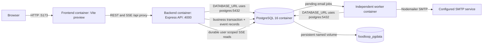

# FoodLoop

FoodLoop is a community food rescue app connecting verified food donors, recipient organizations, and local volunteers. It uses React, Express, PostgreSQL, and transactional database records for donations, reservations, pickup, delivery, notifications, and impact reporting.

## Current implementation

- **Phase 1:** React 19, TypeScript, Vite, Express 5, PostgreSQL, migrations, local database Compose service, health endpoint.
- **Phase 2:** bcrypt authentication, JWT sessions, donor/NGO/volunteer/admin roles, protected routes, organization registration and admin verification.
- **Phase 3:** donation listings, saved service-area matching, reservations, status transitions, quantity locking, expiry processing, admin inspection.
- **Phase 4:** volunteer profiles and availability, assignment offers, acceptance/rejection, hashed pickup and delivery OTPs, attempt limits, delivery records.
- **Phase 5:** transactional notification records, SMTP worker and retry queue, encrypted OTP email payloads, in-app notification center, authenticated replayable SSE, admin notification operations, PostgreSQL analytics.
- **Phase 6:** Dockerfiles for frontend/backend, four-service Docker Compose stack, container networking, persistent PostgreSQL volume, application-managed migrations, and health checks.
- **Phase 7:** Terraform configuration for a single EC2 host, VPC/public networking, restricted SSH, EC2 ECR-pull role, and frontend/backend ECR repositories. `terraform fmt`, `init`, and `validate` passed. The user reports provisioning is complete; AWS state was not independently queried here.
- **Phase 8:** Ansible configured and verified the reported Amazon Linux 2023 EC2 host with Docker Engine, Docker Compose V2, Docker log rotation, Docker group access, and FoodLoop deployment directories. The user confirms the Docker group permission issue was resolved by opening a fresh SSH session.
- **Phase 9:** Production configuration and image push are reported complete for release `p9-20261124-222955`; the user reports the donor dashboard rendered on the existing EC2 host over temporary HTTP. Full service health, database persistence, worker/email, admin bootstrap, HTTPS, and role-by-role integration remain unverified or pending. Real environment values must be created directly on EC2, not copied from the repository.
- **Phase 10:** GitHub Actions CI/CD — pending.
- **Phase 11:** Nagios monitoring — pending.
- **Phase 12:** Integration testing, execution evidence, and final report — pending.

Root Docker Compose supports local development and academic demonstration. The user reports that AWS infrastructure and Phase 8 host configuration are complete. Phase 9 is partially deployed: the user reports the frontend dashboard route rendered at `http://13.200.252.1/dashboard/donor` using a temporary HTTP Caddy configuration. This proves only that the page rendered in a browser; it does not establish API/database health, SSE delivery, service health, persistence, or complete role workflows. HTTP is not suitable for secure public operation; HTTPS, domain/DNS, secret rotation, SMTP/worker verification, admin bootstrap, and production smoke tests remain outstanding. Phases 10–12 remain pending. The web app remains usable if SSE is offline; data can still be fetched through its normal API routes.

## Architecture



Business changes and their in-app notifications, durable user events, and ordinary email jobs are created by PostgreSQL triggers within the originating transaction. A rolled-back business change therefore cannot leave a notification or event behind. Events are stored per recipient and the SSE dispatcher polls once per API process, not once per connected browser. The browser sends its JWT in an `Authorization` header and resumes with `Last-Event-ID`; no access token is placed in a URL.

## Notification worker

The API never waits for SMTP. It writes email jobs to the existing `notification_queue`; a separate process claims jobs using `FOR UPDATE SKIP LOCKED`, sends them with Nodemailer, and saves attempts, errors, retry time, and final status. Retry delay grows exponentially and is bounded. Abandoned claims can be recovered. Job idempotency keys prevent duplicate queue records for the same business event.

SMTP delivery is at least once: if the worker crashes after an SMTP server accepts a message but before PostgreSQL records `sent`, a retry can send that email again. The queue keeps a stable `Message-ID` to help downstream systems identify a retry.

Pickup and delivery OTP issuance has dedicated production endpoints. Those endpoints store only the existing HMAC verification hash and put the email copy in an AES-256-GCM protected queue payload. The worker removes the protected payload after successful delivery or when retries are exhausted. Plaintext codes are not returned by production endpoints or written to logs. The existing development-only code display remains available outside production.

## Database

The migration runner applies numbered SQL files under `database/migrations/` in order and records them in `schema_migrations`. Migrations 007 and 008 add notifications, user-scoped replay events, worker state, transactional business event hooks, and admin activity events. They preserve the existing queue and records. Do not edit an applied migration; add a higher numbered migration for schema changes.

## Run all four containers (Windows PowerShell)

The root Compose file starts PostgreSQL, the Express API, the React frontend, and the notification worker. Copy `.env.example` to `.env`, use a unique local `JWT_SECRET` of at least 32 bytes, and keep `POSTGRES_PASSWORD` consistent with the password in the host `DATABASE_URL`. Do not put SMTP credentials into source control.

```powershell
docker compose build
docker compose up -d
docker compose ps
docker compose logs -f
docker compose logs -f worker
```

Open `http://localhost:5173` (or the host port selected by `FOODLOOP_FRONTEND_HOST_PORT`). Check the API/database health at `http://localhost:4000/api/health` (or the configured API host port). Frontend requests and SSE are forwarded by Vite's preview proxy to the `backend` Compose service. Containers connect to PostgreSQL using the service name `postgres` and port `5432`; host applications continue to use `localhost:5434` by default. If local development servers already occupy 4000 and 5173, choose free ports such as 4001 and 5175 with `FOODLOOP_API_HOST_PORT` and `FOODLOOP_FRONTEND_HOST_PORT`.

The backend waits for PostgreSQL's `pg_isready` health check, then runs the existing migration runner before starting Express. Migration files are not mounted into PostgreSQL's `docker-entrypoint-initdb.d`; this prevents its one-time initialization scripts from applying the same migrations separately from `schema_migrations`. Re-running the app checks migration records and applies only missing migrations. The existing `foodloop_pgdata` named volume is retained across container restarts. On this machine, the stack was built and run with API/frontend host ports 4001/5175 because existing local processes used 4000/5173. All four services reached healthy status; frontend, direct API health, and frontend-proxied API health returned HTTP 200. The backend reported that migrations were current. PostgreSQL was restarted without deleting its volume, and read-only row counts remained unchanged (users 6, organizations 4, donations 3, reservations 2, migrations 8). This verifies local startup, health, migrations, and persistence. It is not a full browser workflow or a real email delivery test; no screenshots were captured.

The worker health check queries the latest worker record and requires a recent heartbeat, no stop timestamp, and no recorded worker error. A running container without configured/reachable SMTP is not reported healthy. Set SMTP values and `NOTIFICATION_ENCRYPTION_KEY` to enable and verify delivery.

To stop containers while preserving the database:

```powershell
docker compose down
```

Do not use `docker compose down -v`; that removes the persistent database volume. The existing PostgreSQL-only command remains available:

```powershell
docker compose up -d postgres
```

When only PostgreSQL is running, use the host `.env` URL and `npm.cmd run db:migrate` before starting the app with `npm.cmd run dev`.

## Local development without app containers (Windows PowerShell)

Requirements: Node.js, npm, and Docker Desktop with its Linux container engine running.

1. Copy `.env.example` to `.env`; set `JWT_SECRET` to a random value with at least 32 bytes. Never commit `.env`.
2. Start the existing PostgreSQL service: `docker compose up -d postgres`.
3. Install dependencies: `npm.cmd install`.
4. Apply migrations: `npm.cmd run db:migrate`.
5. Start API and Vite together: `npm.cmd run dev`.
6. Open `http://localhost:5173`; API health is `http://localhost:4000/api/health`.
7. Run backend integration tests: `npm.cmd test`.

FoodLoop's example host port is **5434**. Compose and `.env.example` default to host port 5434; PostgreSQL always listens on 5432 inside its container. Keep `FOODLOOP_DB_HOST_PORT` and `DATABASE_URL` in `.env` aligned. The default compose volume is persistent; do not remove it to fix connection errors.

### Configure SMTP and run the worker

Set `SMTP_HOST`, `SMTP_PORT`, `SMTP_SECURE`, `SMTP_USER`, `SMTP_PASSWORD`, and `SMTP_FROM` in the untracked `.env`. For OTP email, also set `NOTIFICATION_ENCRYPTION_KEY` to a base64 encoded 32-byte random key. Generate a key with:

```powershell
node -e "console.log(require('node:crypto').randomBytes(32).toString('base64'))"
```

Start the worker in a second terminal from the project root:

```powershell
npm.cmd run notifications:worker
```

Without valid SMTP settings, the worker exits with a clear error and the admin page reports it as offline. Jobs remain in PostgreSQL for later processing. Do not copy real SMTP or encryption secrets into `.env.example`.

## Notification and event APIs

All routes are under `/api/v1` and retain the existing `{ data: ... }` success and `{ error: ... }` failure response envelopes.

| Method | Path | Purpose |
|---|---|---|
| GET | `/notifications` | User's paginated notification history; accepts `unread=true/false` |
| GET | `/notifications/unread-count` | Current user’s unread count |
| PATCH | `/notifications/:id/read` | Mark an owned notification read |
| PATCH | `/notifications/read-all` | Mark all current-user notifications read |
| GET | `/events/stream` | Authenticated user-scoped SSE stream; resumes with `Last-Event-ID` |

Events include donation creation/cancellation/expiry, reservation creation and decisions, volunteer offers and status changes, pickup/delivery confirmation, organization review, new accounts, worker state, and final email failures. The backend chooses each recipient from saved user, organization, service-area, and assignment records. Event payloads contain safe UI signals; pages refetch their authoritative REST resource when relevant events arrive.

## Analytics and admin operations

Admin-only analytics endpoints:

- `GET /api/v1/analytics/overview`
- `GET /api/v1/analytics/donations/monthly`
- `GET /api/v1/analytics/donations/locality`
- `GET /api/v1/analytics/reservations`
- `GET /api/v1/analytics/delivery`

Donation quantities stay grouped by unit. Delivered quantities come from reservation rows verified as delivered; pending or accepted quantities are not counted as delivered. Admin notification operations show actual queue counts, retry records, recent event aggregates, and the database-backed worker heartbeat. They do not expose email bodies, encryption material, or OTPs.

## Tests and builds

Run `npm.cmd test` for existing auth, donation, assignment, and Phase 5 PostgreSQL integration tests. These create isolated random schemas and drop only those test schemas. Run `npm.cmd run build` for frontend TypeScript/Vite and backend TypeScript builds. SMTP behavior is tested with an injected test transport; no real email is required by tests. At the Phase 6 verification snapshot, all 12 backend tests passed and both frontend/backend builds completed successfully.

## Known operational requirements

- The API, PostgreSQL, and notification worker are separate processes; start the worker to send email.
- Live updates require a valid authenticated SSE connection and an available database. The UI shows connection state and falls back to normal API requests.
- Production OTP email requires a configured encryption key and valid SMTP service. Phase 6 confirmed the worker container's health, but did not send a real message to an inbox.
- SMTP has an unavoidable send/record crash window; retries may produce a duplicate email, though queue records themselves are idempotent.
- The user reports Phase 7 infrastructure and Phase 8 Ansible configuration are complete; this session did not independently refresh AWS state. Phase 9 images and temporary HTTP dashboard access are user-reported; broader deployment verification and hardening remain pending. Phases 10 CI/CD, 11 monitoring, and 12 integration evidence/report remain pending. Root Docker Compose continues to support the local four-container stack. See [the Phase 9 deployment runbook](infra/deploy/README.md) for release refs, evidence boundaries, remaining checks, and safe rollback.
