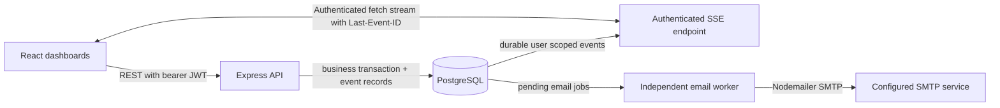

# FoodLoop

FoodLoop is a community food rescue app connecting verified food donors, recipient organizations, and local volunteers. It uses React, Express, PostgreSQL, and transactional database records for donations, reservations, pickup, delivery, notifications, and impact reporting.

## Current implementation

- **Phase 1:** React 19, TypeScript, Vite, Express 5, PostgreSQL, migrations, local database Compose service, health endpoint.
- **Phase 2:** bcrypt authentication, JWT sessions, donor/NGO/volunteer/admin roles, protected routes, organization registration and admin verification.
- **Phase 3:** donation listings, saved service-area matching, reservations, status transitions, quantity locking, expiry processing, admin inspection.
- **Phase 4:** volunteer profiles and availability, assignment offers, acceptance/rejection, hashed pickup and delivery OTPs, attempt limits, delivery records.
- **Phase 5:** transactional notification records, SMTP worker and retry queue, encrypted OTP email payloads, in-app notification center, authenticated replayable SSE, admin notification operations, PostgreSQL analytics.

The repository does not include a production deployment or paid cloud infrastructure. The web app remains usable if SSE is offline; data can still be fetched through its normal API routes.

## Architecture



Business changes and their in-app notifications, durable user events, and ordinary email jobs are created by PostgreSQL triggers within the originating transaction. A rolled-back business change therefore cannot leave a notification or event behind. Events are stored per recipient and the SSE dispatcher polls once per API process, not once per connected browser. The browser sends its JWT in an `Authorization` header and resumes with `Last-Event-ID`; no access token is placed in a URL.

## Notification worker

The API never waits for SMTP. It writes email jobs to the existing `notification_queue`; a separate process claims jobs using `FOR UPDATE SKIP LOCKED`, sends them with Nodemailer, and saves attempts, errors, retry time, and final status. Retry delay grows exponentially and is bounded. Abandoned claims can be recovered. Job idempotency keys prevent duplicate queue records for the same business event.

SMTP delivery is at least once: if the worker crashes after an SMTP server accepts a message but before PostgreSQL records `sent`, a retry can send that email again. The queue keeps a stable `Message-ID` to help downstream systems identify a retry.

Pickup and delivery OTP issuance has dedicated production endpoints. Those endpoints store only the existing HMAC verification hash and put the email copy in an AES-256-GCM protected queue payload. The worker removes the protected payload after successful delivery or when retries are exhausted. Plaintext codes are not returned by production endpoints or written to logs. The existing development-only code display remains available outside production.

## Database

The migration runner applies numbered SQL files under `database/migrations/` in order and records them in `schema_migrations`. Migrations 007 and 008 add notifications, user-scoped replay events, worker state, transactional business event hooks, and admin activity events. They preserve the existing queue and records. Do not edit an applied migration; add a higher numbered migration for schema changes.

## Local development (Windows PowerShell)

Requirements: Node.js, npm, and Docker Desktop with its Linux container engine running.

1. Copy `.env.example` to `.env`; set `JWT_SECRET` to a random value with at least 32 bytes. Never commit `.env`.
2. Start the existing PostgreSQL service: `docker compose up -d postgres`.
3. Install dependencies: `npm.cmd install`.
4. Apply migrations: `npm.cmd run db:migrate`.
5. Start API and Vite together: `npm.cmd run dev`.
6. Open `http://localhost:5173`; API health is `http://localhost:4000/api/health`.
7. Run backend integration tests: `npm.cmd test`.

FoodLoop's example host port is **5434**. Keep `FOODLOOP_DB_HOST_PORT` and `DATABASE_URL` in `.env` aligned. The default compose volume is persistent; do not remove it to fix connection errors.

### Configure SMTP and run the worker

Set `SMTP_HOST`, `SMTP_PORT`, `SMTP_SECURE`, `SMTP_USER`, `SMTP_PASSWORD`, and `SMTP_FROM` in the untracked `.env`. For OTP email, also set `NOTIFICATION_ENCRYPTION_KEY` to a base64 encoded 32-byte random key. Generate a key with:

```powershell
node -e "console.log(require('node:crypto').randomBytes(32).toString('base64'))"
```

Start the worker in a second terminal from the project root:

```powershell
npm.cmd run notifications:worker
```

Without valid SMTP settings, the worker exits with a clear error and the admin page reports it as offline. Jobs remain in PostgreSQL for later processing. Do not copy real SMTP or encryption secrets into `.env.example`.

## Notification and event APIs

All routes are under `/api/v1` and retain the existing `{ data: ... }` success and `{ error: ... }` failure response envelopes.

| Method | Path | Purpose |
|---|---|---|
| GET | `/notifications` | User's paginated notification history; accepts `unread=true/false` |
| GET | `/notifications/unread-count` | Current user’s unread count |
| PATCH | `/notifications/:id/read` | Mark an owned notification read |
| PATCH | `/notifications/read-all` | Mark all current-user notifications read |
| GET | `/events/stream` | Authenticated user-scoped SSE stream; resumes with `Last-Event-ID` |

Events include donation creation/cancellation/expiry, reservation creation and decisions, volunteer offers and status changes, pickup/delivery confirmation, organization review, new accounts, worker state, and final email failures. The backend chooses each recipient from saved user, organization, service-area, and assignment records. Event payloads contain safe UI signals; pages refetch their authoritative REST resource when relevant events arrive.

## Analytics and admin operations

Admin-only analytics endpoints:

- `GET /api/v1/analytics/overview`
- `GET /api/v1/analytics/donations/monthly`
- `GET /api/v1/analytics/donations/locality`
- `GET /api/v1/analytics/reservations`
- `GET /api/v1/analytics/delivery`

Donation quantities stay grouped by unit. Delivered quantities come from reservation rows verified as delivered; pending or accepted quantities are not counted as delivered. Admin notification operations show actual queue counts, retry records, recent event aggregates, and the database-backed worker heartbeat. They do not expose email bodies, encryption material, or OTPs.

## Tests and builds

Run `npm.cmd test` for existing auth, donation, assignment, and Phase 5 PostgreSQL integration tests. These create isolated random schemas and drop only those test schemas. Run `npm.cmd run build` for frontend TypeScript/Vite and backend TypeScript builds. SMTP behavior is tested with an injected test transport; no real email is required by tests.

## Known operational requirements

- The API, PostgreSQL, and notification worker are separate processes; start the worker to send email.
- Live updates require a valid authenticated SSE connection and an available database. The UI shows connection state and falls back to normal API requests.
- Production OTP email requires a configured encryption key and valid SMTP service.
- SMTP has an unavoidable send/record crash window; retries may produce a duplicate email, though queue records themselves are idempotent.
- No Kubernetes, full-stack deployment, cloud provisioning, or external monitoring service is claimed as complete.
