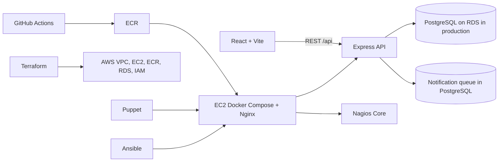

# FoodLoop

FoodLoop is a community food rescue platform that helps local food donors connect surplus meals with nearby recipient organizations and volunteers. It is being developed as a phased full stack and DevOps project. This repository is currently at the Phase 1 foundation: the public web shell, API/database connection, and initial relational schema are present; later workflow and deployment phases are not yet implemented.

## Architecture



The browser talks only to the Express REST API. PostgreSQL is the system of record. In AWS, Terraform provisions the network and managed services; Puppet configures the host baseline; Ansible deploys and rolls back versioned containers; Nginx terminates HTTPS and proxies application traffic; Nagios monitors the host, services, containers, and API health. RDS remains on private subnets. No Kubernetes is planned for version one.

## Repository layout

```text
frontend/                 React, Vite, TypeScript, responsive UI
backend/                  Express API, PostgreSQL pool, migrations runner
database/migrations/      Versioned SQL schema
docker-compose.yml        Local PostgreSQL development service
terraform/                AWS network and service provisioning (planned)
puppet/                   Host configuration management (planned)
ansible/                  Deployment and rollback (planned)
nagios/                   Nagios Core configuration (planned)
nginx/                    Reverse proxy and HTTPS configuration (planned)
docs/                     API, architecture, deployment, and project report (planned)
.github/workflows/        CI/CD pipeline (planned)
```

## Database model

`users` hold login identities and roles. An `organizations` row belongs to a user and represents a donor or recipient; recipient service areas are recorded in `service_areas`. Donors publish `donations` with location, quantity, handling, and collection deadline. `reservations` link a recipient to a donation and are constrained to one reservation per organization per donation. Volunteer profiles and `reservation_assignments` model pickup and delivery work, including OTP hashes and verification times. `notification_queue` stores durable outbound mail jobs and retry state. Foreign keys, check constraints, unique constraints, and location/deadline indexes are included in the initial migration.

## Local development

Requirements: Node.js 22 or newer, npm, and Docker Desktop with Docker Compose.

1. Copy `.env.example` to `.env` and set a local `DATABASE_URL` if needed. The included values are development-only and must not be used in production.
2. Start PostgreSQL with `docker compose up -d postgres`.
3. Install workspace dependencies with `npm install`.
4. Apply the schema with `npm run db:migrate`.
5. Start the API and web client with `npm run dev`.
6. Open `http://localhost:5173`; API health is at `http://localhost:4000/api/health`.

Compose initializes the schema on a new database volume as well. The migration runner is safe to re-run for the current idempotent initial migration. The backend returns HTTP 503 from health when PostgreSQL is unavailable.

## Initial API surface

| Method | Path | Purpose |
|---|---|---|
| GET | `/api/health` | API process and PostgreSQL health |
| GET | `/api/v1` | API version discovery |

Authentication and application resource endpoints will be added in their scheduled phases; the current UI is a public landing shell and does not imply those workflows are live.

## Planned implementation phases

1. Repository, React, Express, and PostgreSQL foundation (in progress)
2. Authentication, roles, and organization management
3. Donations, locality matching, and concurrency-safe reservations
4. Volunteer assignment, OTP, and delivery tracking
5. Email worker, retry handling, and analytics
6. Docker images and full Docker Compose stack
7. Terraform AWS infrastructure
8. Puppet host configuration
9. Ansible deployment and rollback
10. GitHub Actions CI/CD and Trivy image scanning
11. Nagios monitoring and recovery demonstrations
12. Admin DevOps Control Center with trusted deployment records
13. AWS deployment and end-to-end verification, subject to explicit approval before paid provisioning
14. Documentation, evidence, project report, and viva preparation

Do not treat planned infrastructure or unimplemented workflows as deployed or verified. AWS resources will not be provisioned or deleted without explicit approval.
