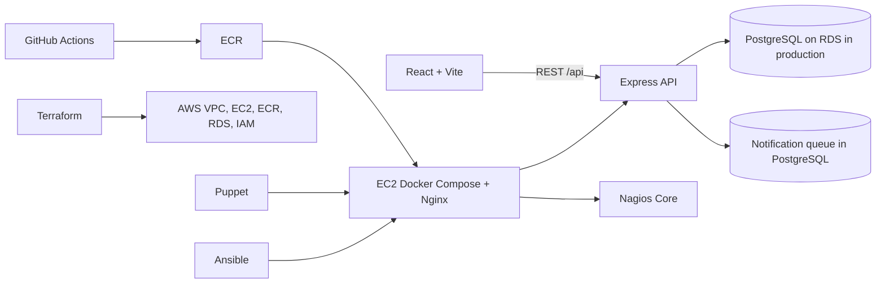

# FoodLoop

FoodLoop is a community food rescue platform that helps local food donors connect surplus meals with nearby recipient organizations and volunteers. It is being developed as a phased full stack and DevOps project. The repository includes the application foundation, account and organization workflows, an admin review center, and redesigned role dashboards. Donation, reservation, volunteer task assignment, notification, analytics, and DevOps workflows remain planned and are shown as unavailable until implemented.

## Architecture



The browser talks only to the Express REST API. PostgreSQL is the system of record. In AWS, Terraform provisions the network and managed services; Puppet configures the host baseline; Ansible deploys and rolls back versioned containers; Nginx terminates HTTPS and proxies application traffic; Nagios monitors the host, services, containers, and API health. RDS remains on private subnets. No Kubernetes is planned for version one.

## Repository layout

```text
frontend/                 React, Vite, TypeScript, responsive UI
backend/                  Express API, PostgreSQL pool, migrations runner
database/migrations/      Versioned SQL schema
backend/test/             Isolated PostgreSQL authentication/authorization integration tests
docker-compose.yml        Local PostgreSQL development service
terraform/                AWS network and service provisioning (planned)
puppet/                   Host configuration management (planned)
ansible/                  Deployment and rollback (planned)
nagios/                   Nagios Core configuration (planned)
nginx/                    Reverse proxy and HTTPS configuration (planned)
docs/                     API, architecture, deployment, and project report (planned)
.github/workflows/        CI/CD pipeline (planned)
```

## Database model

`users` hold login identities and roles. An `organizations` row belongs to a user and represents a donor or recipient; recipient service areas are recorded in `service_areas`. Donors publish `donations` with location, quantity, handling, and collection deadline. `reservations` link a recipient to a donation and are constrained to one reservation per organization per donation. Volunteer profiles and `reservation_assignments` model pickup and delivery work, including OTP hashes and verification times. `notification_queue` stores durable outbound mail jobs and retry state. Foreign keys, check constraints, unique constraints, and location/deadline indexes are included in the initial migration.

## Local development

Requirements: Node.js 22 or newer, npm, and Docker Desktop with Docker Compose.

1. Copy `.env.example` to `.env`, set a local `DATABASE_URL`, and set `JWT_SECRET` to a random secret of at least 32 bytes. For example, generate one with `node -e "console.log(require('node:crypto').randomBytes(48).toString('base64url'))"`. The included database values are development-only and must not be used in production.
2. Start PostgreSQL with `docker compose up -d postgres`.
3. Install workspace dependencies with `npm install`.
4. Apply all new migrations with `npm run db:migrate`. The migration ledger skips files already applied; the initial migration is safe to re-run against its existing tables and does not delete data.
5. Start the API and web client with `npm run dev`.
6. Open `http://localhost:5173`; API health is at `http://localhost:4000/api/health`.
7. Run the backend integration tests with `npm run test`. Tests create a random temporary PostgreSQL schema, run migrations there, and drop that schema at completion. They do not clear the app's existing tables.

Compose initializes the schema on a new database volume as well. The migration runner is safe to re-run for the current idempotent initial migration. The backend returns HTTP 503 from health when PostgreSQL is unavailable.

## Authentication and organization API

| Method | Path | Purpose |
|---|---|---|
| GET | `/api/health` | API process and PostgreSQL health |
| GET | `/api/v1` | API version discovery |
| POST | `/api/v1/auth/register` | Register donor, NGO, or volunteer account; organization/profile creation is transactional |
| POST | `/api/v1/auth/login` | Verify bcrypt password and issue an expiring signed JWT |
| POST | `/api/v1/auth/enroll-phone` | Securely add a phone to a legacy account after verifying email and password |
| GET | `/api/v1/auth/me` | Return the current active user from the database (Bearer token required) |
| POST | `/api/v1/organizations` | Register a donor or recipient organization for a signed-in account |
| GET | `/api/v1/organizations/me` | Read the signed-in organization's verification and service area details |
| GET | `/api/v1/admin/organizations?status=pending` | Admin-only verification queue from PostgreSQL |
| PATCH | `/api/v1/admin/organizations/:id/verification` | Admin-only verified/rejected decision with reviewer, timestamp, and optional note |
| GET | `/api/v1/admin/overview` | Admin-only database-backed counts and recent registrations/reviews |
| GET | `/api/v1/admin/users` | Admin-only searchable, paginated user list with optional role and active filters |
| GET | `/api/v1/volunteers/me` | Read the signed-in volunteer's stored profile |

Successful responses use a `data` envelope; errors use an `error` envelope with a stable code, message, and optional validation details. Registration excludes the admin role. Create the first administrator only through the protected local seed command; there is no public admin registration endpoint.

### Admin bootstrap

Set `ADMIN_EMAIL`, `ADMIN_FULL_NAME`, a unique `ADMIN_PASSWORD` (at least 16 characters), and `ADMIN_PHONE` in E.164 format in the shell environment, then run `npm run db:seed-admin`. The script hashes the password with bcrypt and refuses to promote or overwrite an account with that email. Do not commit real credentials. `.env.example` contains placeholders only.

Existing accounts created before phone became required keep their password and data. On their first login, enter the email, password, and phone number, then use the secure phone enrollment prompt to attach that number to the account.

### Frontend routes

- `/` — public landing page
- `/login`, `/register` — API-connected account forms
- `/dashboard` — redirects to the signed-in user's role dashboard
- `/dashboard/donor`, `/dashboard/ngo`, `/dashboard/volunteer`, `/dashboard/admin` — protected by session and role
- Admin pages: `/dashboard/admin/organizations`, `/dashboard/admin/users`, `/dashboard/admin/donors`, `/dashboard/admin/ngos`, `/dashboard/admin/volunteers`, and `/dashboard/admin/trust`.
- Unimplemented donations, reservations, volunteer tasks, notifications, analytics, and DevOps routes are clearly marked as coming soon. Dashboards do not fabricate activity counts or deployment status.

## Planned implementation phases

1. Repository, React, Express, and PostgreSQL foundation (complete)
2. Authentication, roles, organization management, admin review, and redesigned dashboards (implemented; workflows listed as coming soon remain incomplete)
3. Donations, locality matching, and concurrency-safe reservations
4. Volunteer assignment, OTP, and delivery tracking
5. Email worker, retry handling, and analytics
6. Docker images and full Docker Compose stack
7. Terraform AWS infrastructure
8. Puppet host configuration
9. Ansible deployment and rollback
10. GitHub Actions CI/CD and Trivy image scanning
11. Nagios monitoring and recovery demonstrations
12. Admin DevOps Control Center with trusted deployment records
13. AWS deployment and end-to-end verification, subject to explicit approval before paid provisioning
14. Documentation, evidence, project report, and viva preparation

Do not treat planned infrastructure or unimplemented workflows as deployed or verified. AWS resources will not be provisioned or deleted without explicit approval.
